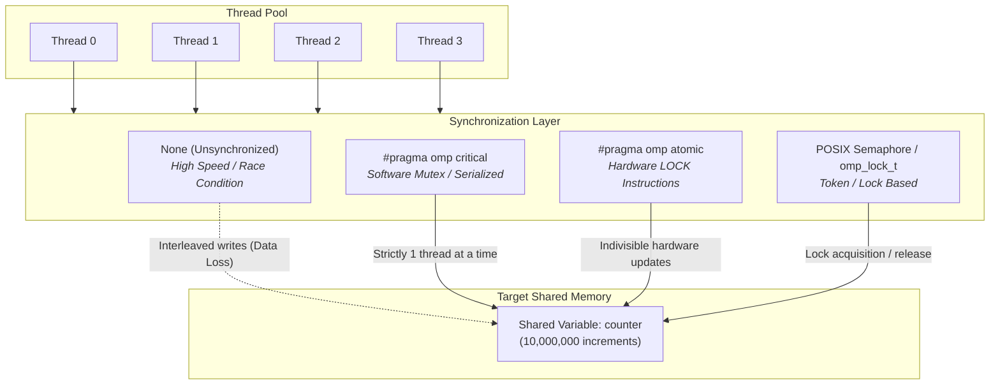

# Analyze Synchronization Mechanisms in Parallel Programs

## Experiment 5 — Parallel Computing Laboratory

**Author:** Krish-119  
**Institution:** KLE Technological University  

---

## Table of Contents

- [1. Objective](#1-objective)
- [2. Software Requirements & Environment](#2-software-requirements--environment)
- [3. Theoretical Background](#3-theoretical-background)
  - [3.1 Why Synchronization is Needed](#31-why-synchronization-is-needed)
  - [3.2 Race Condition](#32-race-condition)
  - [3.3 Critical Section](#33-critical-section)
  - [3.4 Atomic Operation](#34-atomic-operation)
  - [3.5 Barrier Synchronization](#35-barrier-synchronization)
  - [3.6 POSIX Semaphore](#36-posix-semaphore)
  - [3.7 Correctness vs. Performance vs. Scalability](#37-correctness-vs-performance-vs-scalability)
- [4. Synchronization Architecture Diagram](#4-synchronization-architecture-diagram)
- [5. Setup & Compilation Guide](#5-setup--compilation-guide)
- [6. Implemented Programs](#6-implemented-programs)
  - [6.1 Program 1: Race Condition (`race.c`)](#61-program-1-race-condition-racec)
  - [6.2 Program 2: Critical Section (`critical.c`)](#62-program-2-critical-section-criticalc)
  - [6.3 Program 3: Atomic Operation (`atomic.c`)](#63-program-3-atomic-operation-atomicc)
  - [6.4 Program 4: Barrier Synchronization (`barrier.c`)](#64-program-4-barrier-synchronization-barrierc)
  - [6.5 Program 5: POSIX Semaphore (`semaphore.c`)](#65-program-5-posix-semaphore-semaphorec)
  - [6.6 Program 6: Comparative Benchmark (`compare_sync.c`)](#66-program-6-comparative-benchmark-compare_syncc)
- [7. Experimental Execution Results & Screenshots](#7-experimental-execution-results--screenshots)
- [8. Benchmark Analysis & Performance Comparison](#8-benchmark-analysis--performance-comparison)
- [9. Comparison & Observation Table](#9-comparison--observation-table)
- [10. Key Insights & Conclusion](#10-key-insights--conclusion)

---

## 1. Objective

To implement and evaluate common synchronization mechanisms used in shared-memory parallel programming:
- Unsynchronized execution (demonstrating race conditions and silent data loss)
- Critical Sections (`#pragma omp critical`)
- Atomic Operations (`#pragma omp atomic`)
- Barrier Synchronization (`#pragma omp barrier`)
- Semaphores and Locks (POSIX `sem_t` and OpenMP `omp_lock_t`)

The primary goals are to assess:
1. **Correctness**: Whether the mechanism guarantees mutual exclusion and consistent results under concurrent workloads.
2. **Execution Time**: The latency overhead imposed by the synchronization primitives.
3. **Scalability**: How the synchronization strategy behaves as thread counts scale from 1 to 8 cores.

---

## 2. Software Requirements & Environment

| S.No. | Software / Tool | Purpose / Specification |
|:---:|:---|:---|
| 1 | **VMware Workstation Pro** | Virtualization hypervisor hosting Ubuntu guest OS |
| 2 | **Ubuntu Linux (krish@KLAP)** | Guest operating system environment |
| 3 | **GCC Compiler (v15.2.0)** | C compiler (`build-essential`) with OpenMP support |
| 4 | **OpenMP (`libgomp`)** | Compiler directives for multithreading, atomics, and locks |
| 5 | **POSIX Threads (`pthread`) & Semaphore** | `sem_init`, `sem_wait`, `sem_post`, `sem_destroy` |
| 6 | **Ubuntu Terminal** | Build automation, binary execution, and telemetry logging |

---

## 3. Theoretical Background

### 3.1 Why Synchronization is Needed
In shared-memory parallel architectures, multiple threads execute concurrently within the same address space and can read and write shared memory locations. If multiple threads perform a **read-modify-write** sequence (such as `counter++`) on a shared variable without coordination, their instructions interleave non-deterministically. This interleaving causes conflicting updates, yielding incorrect results that vary from run to run. Synchronization primitives coordinate memory access to ensure determinism and program correctness.

### 3.2 Race Condition
A race condition occurs when the system's output depends on the uncoordinated scheduling sequence of competing threads. 
The increment operation `counter++` is not atomic at the hardware level; it expands to three distinct CPU instructions:
1. `MOV eax, [counter]` (Read shared variable into register)
2. `ADD eax, 1` (Increment register value)
3. `MOV [counter], eax` (Write updated register back to memory)

When two threads execute these steps simultaneously, both may read identical old values before either writes back, resulting in lost updates. Race conditions offer minimal latency (zero synchronization overhead) but produce invalid, non-deterministic state.

### 3.3 Critical Section
A critical section (`#pragma omp critical`) specifies a region of code that must be executed by only one thread at a time. All other threads attempting to enter the section are blocked until the owning thread exits.
- **Advantage**: Guarantees mutual exclusion for arbitrary, multi-line blocks of code.
- **Disadvantage**: Serializes execution, creating severe lock contention and scalability degradation as thread counts increase.

### 3.4 Atomic Operation
An atomic operation (`#pragma omp atomic`) enforces that a single memory location is updated indivisibly. Unlike general-purpose mutexes, atomics leverage hardware-level CPU instructions (such as `LOCK CMPXCHG`, `LOCK XADD` on x86/x64).
- **Advantage**: Very low overhead, no operating-system thread scheduling intervention, and superior scalability for primitive read-modify-write operations.
- **Limitation**: Limited to basic binary and unary expressions; cannot guard complex multi-statement critical regions.

### 3.5 Barrier Synchronization
A barrier (`#pragma omp barrier`) establishes a phase boundary where all threads in the team must arrive before any thread is allowed to continue execution.
- Used to align computational phases (e.g., ensuring all threads complete step $k$ before any thread initiates step $k+1$).
- Waiting overhead is bounded by the slowest-running thread in the team.

### 3.6 POSIX Semaphore
A semaphore (`sem_t`) is a kernel- and user-space synchronization primitive maintaining an internal integer counter:
- `sem_wait()`: Decrements the counter; blocks if the counter is 0.
- `sem_post()`: Increments the counter and unblocks waiting threads.
- A **binary semaphore** (initialized to 1) behaves as a mutual-exclusion lock protecting shared state between threads.

### 3.7 Correctness vs. Performance vs. Scalability

```
                ┌──────────────────────────────────────┐
                │          Design Trade-offs           │
                ├──────────────────────────────────────┤
                │  • Correctness: Accurate tally?      │
                │  • Performance: Low single-run time? │
                │  • Scalability: Speedup with cores?  │
                └──────────────────────────────────────┘
```
1. **Correctness**: Absolute requirement for scientific and financial computing.
2. **Performance**: Overhead introduced by locking, syscalls, and cache invalidation.
3. **Scalability**: Ability to maintain or improve throughput as core count grows ($1 \to 2 \to 4 \to 8$).

---

## 4. Synchronization Architecture Diagram



---

## 5. Setup & Compilation Guide

### Package Installation
```bash
sudo apt update
sudo apt install build-essential -y
```

### Build All Programs using Makefile
```bash
cd src
make
```

### Manual Compilation Commands
```bash
# Program 1: Race Condition
gcc race.c -fopenmp -o race

# Program 2: Critical Section
gcc critical.c -fopenmp -o critical

# Program 3: Atomic Operation
gcc atomic.c -fopenmp -o atomic

# Program 4: Barrier Synchronization
gcc barrier.c -fopenmp -o barrier

# Program 5: POSIX Semaphore
gcc semaphore.c -pthread -o semaphore

# Program 6: Comparative Benchmark
gcc compare_sync.c -fopenmp -o compare_sync
```

---

## 6. Implemented Programs

### 6.1 Program 1: Race Condition (`race.c`)
Demonstrates unsynchronized concurrent increments across threads.
```c
#include <stdio.h>
#include <omp.h>

int main() {
    long counter = 0;
    #pragma omp parallel for
    for (long i = 0; i < 10000000; i++) {
        counter++;
    }
    printf("Counter=%ld\n", counter);
    return 0;
}
```

### 6.2 Program 2: Critical Section (`critical.c`)
Guarantees mutual exclusion using `#pragma omp critical`.
```c
#include <stdio.h>
#include <omp.h>

int main() {
    long counter = 0;
    #pragma omp parallel for
    for (long i = 0; i < 10000000; i++) {
        #pragma omp critical
        {
            counter++;
        }
    }
    printf("Counter=%ld\n", counter);
    return 0;
}
```

### 6.3 Program 3: Atomic Operation (`atomic.c`)
Protects counter modification via lightweight hardware-level atomic operations.
```c
#include <stdio.h>
#include <omp.h>

int main() {
    long counter = 0;
    #pragma omp parallel for
    for (long i = 0; i < 10000000; i++) {
        #pragma omp atomic
        counter++;
    }
    printf("Counter=%ld\n", counter);
    return 0;
}
```

### 6.4 Program 4: Barrier Synchronization (`barrier.c`)
Coordinates thread execution phases using `#pragma omp barrier`.
```c
#include <stdio.h>
#include <omp.h>

int main() {
    #pragma omp parallel
    {
        printf("Thread %d before barrier\n", omp_get_thread_num());
        #pragma omp barrier
        printf("Thread %d after barrier\n", omp_get_thread_num());
    }
    return 0;
}
```

### 6.5 Program 5: POSIX Semaphore (`semaphore.c`)
Demonstrates binary semaphore mutual exclusion with POSIX threads.
```c
#include <stdio.h>
#include <pthread.h>
#include <semaphore.h>

sem_t semaphore;
int counter = 0;

void* work(void* a) {
    for (int i = 0; i < 100000; i++) {
        sem_wait(&semaphore);
        counter++;
        sem_post(&semaphore);
    }
    return NULL;
}

int main() {
    pthread_t t1, t2;
    sem_init(&semaphore, 0, 1);
    pthread_create(&t1, NULL, work, NULL);
    pthread_create(&t2, NULL, work, NULL);
    pthread_join(t1, NULL);
    pthread_join(t2, NULL);
    printf("Counter=%d\n", counter);
    sem_destroy(&semaphore);
    return 0;
}
```

### 6.6 Program 6: Comparative Benchmark (`compare_sync.c`)
Runs all four mechanisms (None, Critical, Atomic, Lock) across 1, 2, 4, and 8 threads for 10,000,000 shared increments, measuring wall-clock execution time and checking correctness.

---

## 7. Experimental Execution Results & Screenshots

### 1. Environment Verification & Race Condition
Verification of GCC version 15.2.0, OpenMP support, and the first execution of `./race` demonstrating lost updates (`Counter = 775496` instead of `10000000`).


---

### 2. Critical Section Synchronization
Compilation and execution of `./critical`, successfully serializing access and producing the exact expected result: `Counter = 10000000`.


---

### 3. Barrier Synchronization
Execution of `./barrier` illustrating that all 18 threads complete their "before barrier" phase prior to any thread entering the "after barrier" phase.


---

### 4. POSIX Semaphore Execution
Execution of `./semaphore` across two worker threads performing 100,000 protected increments each, yielding the exact total: `Counter = 200000`.


---

### 5. Comprehensive Benchmark & Scalability Evaluation
Full benchmark run across 1, 2, 4, and 8 threads comparing None, Critical, Atomic, and Lock mechanisms for 10,000,000 iterations.


---

## 8. Benchmark Analysis & Performance Comparison

### Measured Empirical Data (krish@KLAP)

| Mechanism | Threads ($T$) | Expected Count | Final Count | Correctness | Time (seconds) |
|:---|:---:|:---:|:---:|:---:|:---:|
| **None** | 1 | 10,000,000 | 10,000,000 | **Correct** | **0.0114** |
| **Critical** | 1 | 10,000,000 | 10,000,000 | **Correct** | 0.2164 |
| **Atomic** | 1 | 10,000,000 | 10,000,000 | **Correct** | 0.1363 |
| **Lock** | 1 | 10,000,000 | 10,000,000 | **Correct** | 0.2146 |
| | | | | | |
| **None** | 2 | 10,000,000 | 6,316,341 | ❌ **INCORRECT** | **0.0209** |
| **Critical** | 2 | 10,000,000 | 10,000,000 | **Correct** | 0.5283 |
| **Atomic** | 2 | 10,000,000 | 10,000,000 | **Correct** | **0.3236** |
| **Lock** | 2 | 10,000,000 | 10,000,000 | **Correct** | 0.7448 |
| | | | | | |
| **None** | 4 | 10,000,000 | 5,303,565 | ❌ **INCORRECT** | **0.0253** |
| **Critical** | 4 | 10,000,000 | 10,000,000 | **Correct** | 1.1181 |
| **Atomic** | 4 | 10,000,000 | 10,000,000 | **Correct** | **0.3867** |
| **Lock** | 4 | 10,000,000 | 10,000,000 | **Correct** | 2.4513 |
| | | | | | |
| **None** | 8 | 10,000,000 | 2,681,003 | ❌ **INCORRECT** | **0.0319** |
| **Critical** | 8 | 10,000,000 | 10,000,000 | **Correct** | 2.5889 |
| **Atomic** | 8 | 10,000,000 | 10,000,000 | **Correct** | **0.4004** |
| **Lock** | 8 | 10,000,000 | 10,000,000 | **Correct** | 3.9011 |

---

### Detailed Analysis & Scalability Trends

```
Execution Time vs. Thread Count (Lower is Better)
Time (s)
 4.0 ┼                                                  ● Lock (3.9011s)
 3.5 ┼
 3.0 ┼
 2.5 ┼                                        ● Critical (2.5889s)
 2.0 ┼                         ● Lock (2.4513s)
 1.5 ┼
 1.0 ┼                         ● Critical (1.1181s)
 0.5 ┼        ● Critical (0.528s)
     ┼  ● Atomic (0.136s)      ● Atomic (0.386s)      ● Atomic (0.400s)
 0.0 ┼──┴──────────────────────┴──────────────────────┴────────────────────
       1 Thread               4 Threads              8 Threads
```

1. **Unsynchronized (`None`)**:
   - Fastest execution time (~0.0114s - 0.0319s) because no lock or atomic overhead is incurred.
   - However, correctness collapses completely when thread count > 1:
     - 2 threads: **6,316,341** (~36.8% data lost)
     - 4 threads: **5,303,565** (~47.0% data lost)
     - 8 threads: **2,681,003** (~73.2% data lost)
   - As more threads compete for memory, race collision frequency escalates dramatically.

2. **Atomic Operations (`#pragma omp atomic`)**:
   - **Best scaling among all correct synchronization methods**:
     - At 1 thread: 0.1363s
     - At 8 threads: 0.4004s (only ~2.9x increase despite 8 concurrent threads hammering the same cache line).
   - Utilizes direct CPU instruction set primitives without operating system scheduler overhead.

3. **Critical Section (`#pragma omp critical`)**:
   - Time degrades from 0.2164s (1 thread) to **2.5889s** (8 threads) — an increase of **~12x**.
   - Causes heavy thread contention and convoying because every thread serializes at the entrance of the critical block.

4. **Locks (`omp_lock_t`)**:
   - Time degrades from 0.2146s (1 thread) to **3.9011s** (8 threads) — an increase of **~18x**.
   - Lock acquire and release routines introduce substantial software overhead under high thread contention.

---

## 9. Comparison & Observation Table

| Mechanism | Correctness Guarantee | Relative Performance | Scalability Characteristics | Best Suited For |
|:---|:---:|:---:|:---|:---|
| **None (Race Condition)** | ❌ **Incorrect** (High Data Loss) | Fastest (Zero synchronization overhead) | **Poor** — Lost updates worsen as thread count increases | Baseline benchmarking / read-only data |
| **Critical Section** |  **Correct** | Slowest for high thread counts | **Poor** — Contention bottleneck grows with thread count | Multi-statement blocks, complex data updates |
| **Atomic Operation** |  **Correct** | **Fast** (Hardware-assisted) | **Excellent** — Low latency, minimal degradation with thread scaling | Single variable increments, arithmetic accumulators |
| **Lock (`omp_lock_t`)** |  **Correct** | Slow (High locking overhead) | **Poor to Moderate** — Thread convoying under tight loops | Fine-grained data structures, linked lists |
| **Barrier** | Phase Sync Only | Overhead proportional to slowest thread | **Moderate** — Limited by thread load imbalances | Multi-phase algorithms (e.g., iterative solvers) |
| **Semaphore** |  **Correct** | Moderate (OS syscall overhead) | **Moderate** — Good for resource management | Bounded buffers, producer-consumer queues |

---

## 10. Key Insights & Conclusion

1. **Race Conditions are Fatal**: Even for a simple loop counter, unsynchronized parallel execution loses over 73% of updates at 8 threads. Concurrency without synchronization leads to non-deterministic failure.
2. **Atomics Outperform Coarse Locks**: For scalar updates, hardware-supported atomics (`#pragma omp atomic`) outperform critical sections and locks by **6.5x to 9.7x** at 8 threads.
3. **Lock Contention Destroys Scalability**: Adding more threads to a code section serialized by a coarse lock or critical section increases total execution time rather than decreasing it.
4. **Summary Guideline**:
   - For basic scalar updates: Use **Atomic operations**.
   - For complex, multi-variable transactions: Use **Critical sections** or **fine-grained Locks**.
   - For algorithmic phase alignment: Use **Barriers**.
   - For multi-resource pooling: Use **Semaphores**.

---

## Author

**Krish-119**  
*Parallel and GPU Computing Laboratory*  
GitHub: [https://github.com/Krish-119/pgc_lab](https://github.com/Krish-119/pgc_lab)
