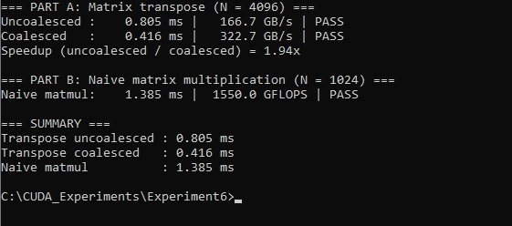

# Experiment 6: Memory Optimization in CUDA

## 1. Experiment Title
**Memory Optimization in CUDA: Coalesced vs. Uncoalesced Access, Shared-Memory Tiling, and Naive Matrix Multiplication Execution-Time Comparison**

---

## 2. Aim
To study how the global-memory access pattern of a CUDA kernel affects its performance by comparing an **uncoalesced** and a **coalesced** matrix transpose, running a **naive matrix multiplication**, and evaluating execution times, effective bandwidth (GB/s), and computational throughput (GFLOPS) measured on the GPU using high-resolution CUDA events.

### Learning Outcomes
- Explain what memory coalescing is and why it determines global-memory bandwidth utilization on NVIDIA GPUs.
- Formulate, configure, and launch 2D CUDA kernels utilizing `dim3` block and grid hierarchies.
- Utilize on-chip shared memory as an intermediate staging buffer to convert strided, uncoalesced memory access into contiguous, coalesced transactions.
- Eliminate shared-memory bank conflicts using memory padding techniques (e.g., `tile[TILE][TILE + 1]`).
- Accurately profile asynchronous GPU execution streams using native CUDA events (`cudaEventRecord`, `cudaEventElapsedTime`).
- Numerically verify GPU kernel outputs against CPU reference implementations.

---

## 3. Problem Statement
Graphics Processing Units (GPUs) offer immense theoretical peak compute and hundreds of gigabytes per second of device memory (DRAM) bandwidth. However, global memory latency is between 400 and 800 clock cycles. To mask this latency, the GPU hardware relies on high thread-level parallelism and **memory coalescing**.

When threads within a warp (a unit of 32 parallel threads) access disparate or strided memory addresses, the memory controller cannot combine the requests into a single transaction. Instead, it must issue multiple discrete memory transactions, discarding unused data words and drastically reducing the effective memory bandwidth.

This experiment evaluates:
1. **Matrix Transpose**:
   - In an out-of-place matrix transpose ($B[j, i] = A[i, j]$), either the reads or the writes must cross row boundaries (strided access by $N$).
   - A naive implementation reads rows contiguously but writes columns with a stride of $N$, generating uncoalesced memory writes.
   - An optimized implementation loads square tiles into fast, on-chip **shared memory** in a coalesced manner, transposes the coordinates locally, and writes back to global memory in a fully coalesced pattern.
2. **Bank Conflict Elimination**:
   - Accessing columns of a 2D shared-memory tile can trigger shared-memory bank conflicts across the 32 hardware banks. Padding the tile column dimension ($32 \times 33$) eliminates bank conflicts.
3. **Naive Matrix Multiplication**:
   - Evaluating memory-bound workloads where threads repeatedly read global memory without shared-memory data reuse, quantifying the resulting GFLOPS limitation.

---

## 4. Introduction
Modern NVIDIA GPUs execute instructions via the Single Instruction, Multiple Threads (SIMT) execution model. Warp schedulers dispatch instructions in groups of 32 threads. When a warp executes an instruction that accesses global device memory (DRAM), the memory management unit inspects the target memory addresses requested by all 32 threads:
- **Coalesced Access**: If the target addresses fall within contiguous, aligned segments (typically 32-byte, 64-byte, or 128-byte cache lines), the hardware merges them into as few as 1 to 4 memory transactions.
- **Uncoalesced Access**: If the addresses are non-contiguous or strided (e.g., accessing an entire column of a row-major matrix), each thread requires an independent transaction. A warp of 32 threads may require up to 32 separate transactions, wasting up to 96.8% of the fetched bytes.

Shared memory is an on-chip, user-managed cache with latency comparable to L1 cache (15–30 cycles) and aggregate bandwidth exceeding several terabytes per second. By staging a tile of data in shared memory, kernels can read globally coalesced, reorder elements locally in shared memory, and write back globally coalesced.

---

## 5. Theory

```
Global Memory (DRAM)                  On-Chip Shared Memory Tile [32][33]                Global Memory (DRAM)
=====================                 ===================================                =====================
[Row 0: 0, 1, 2, ...] --(Coalesced)--> [ [T0,0  T0,1  T0,2 ... ] ]                        [Row 0: 0, N, ...]
                                       [ [T1,0  T1,1  T1,2 ... ] ] --(Coalesced Write)--> [Row 1: 1, N+1, ...]
                                       [ [ ...                 ] ] (after __syncthreads)
                                       (+1 padding prevents bank conflicts)
```

### 5.1 Memory Coalescing
For a warp of 32 threads where thread $i \in [0, 31]$:
- **Coalesced**: Thread $i$ accesses memory index $\text{base} + i$. All 32 floats (128 bytes) lie contiguously within a single 128-byte DRAM cache line. Exactly **1 memory transaction** satisfies the entire warp. Bandwidth utilization is nearly 100%.
- **Uncoalesced (Stride $N$)**: Thread $i$ accesses memory index $\text{base} + i \times N$. For $N = 4096$, each thread points to an address $4096 \times 4\text{ bytes} = 16\text{ KB}$ apart. Every thread requires a separate 32-byte transaction (fetching 32 bytes to use only 4 bytes). A total of **32 memory transactions** are required per warp. Bandwidth utilization drops to $\frac{4}{32} = 12.5\%$.

| Access Type | Target Address of Thread $i$ | Transactions per Warp | Bandwidth Utilization |
|:---|:---|:---:|:---:|
| **Coalesced** | $\text{base} + i$ | Few ($1$ to $4$) | $\approx 100\%$ (Near Peak) |
| **Uncoalesced** | $\text{base} + i \times N$ (stride $N$) | Up to $32$ | $\le 12.5\%$ (Small Fraction) |

---

### 5.2 Matrix Transpose Kernels

#### Kernel 1: Uncoalesced (Naive) Transpose
```cuda
int x = blockIdx.x * TILE + threadIdx.x; // column
int y = blockIdx.y * TILE + threadIdx.y; // row
if (x < N && y < N)
    out[x * N + y] = in[y * N + x];
```
- **Read**: `in[y * N + x]` has consecutive `threadIdx.x` reading consecutive memory addresses (`y * N + x`, `y * N + x + 1`, ...). This read is **coalesced**.
- **Write**: `out[x * N + y]` has consecutive `threadIdx.x` writing to addresses separated by $N$ floats (`x * N + y`, `(x+1) * N + y`, ...). This write is **uncoalesced (stride $N$)**, bottlenecking the memory controller.

#### Kernel 2: Coalesced Transpose with Shared Memory
To achieve coalesced writes as well:
1. Threads load a $32 \times 32$ sub-matrix contiguously into shared memory:
   ```cuda
   tile[threadIdx.y][threadIdx.x] = in[y * N + x];
   ```
2. Barrier synchronization `__syncthreads()` guarantees all 1024 threads in the block finish loading.
3. Block coordinates are transposed (`x = blockIdx.y * TILE + threadIdx.x`, `y = blockIdx.x * TILE + threadIdx.y`), and threads write out to global memory contiguously:
   ```cuda
   out[y * N + x] = tile[threadIdx.x][threadIdx.y];
   ```
Both global read and global write operations are 100% coalesced.

#### Shared-Memory Bank Conflict Avoidance
Shared memory is divided into 32 equal-sized memory banks (4 bytes per bank, interleaved):
$$\text{Bank Index} = (\text{Byte Address} / 4) \pmod{32}$$
- If `tile` is declared `float tile[32][32]`:
  $$\text{Address}(y, x) = y \times 32 + x$$
  When threads in a warp read a column (`threadIdx.x` is fixed, `threadIdx.y` varies from 0 to 31):
  $$\text{Bank} = (y \times 32 + x) \pmod{32} = x \pmod{32}$$
  All 32 threads request data from the exact same bank $x$, causing a **32-way bank conflict** and serializing memory access into 32 separate phases.
- By declaring `float tile[32][33]` (+1 column padding):
  $$\text{Address}(y, x) = y \times 33 + x$$
  $$\text{Bank} = (y \times 33 + x) \pmod{32} = (y + x) \pmod{32}$$
  Since $y \in [0, 31]$ maps to distinct bank indices, all 32 threads access distinct banks concurrently in **1 clock cycle** without conflict!

---

### 5.3 Naive Matrix Multiplication ($C = A \times B$)
For $N \times N$ matrices:
$$C[i, j] = \sum_{k=0}^{N-1} A[i, k] \times B[k, j]$$
In the naive kernel:
```cuda
int row = blockIdx.y * BLK + threadIdx.y;
int col = blockIdx.x * BLK + threadIdx.x;
if (row < N && col < N) {
    float sum = 0.0f;
    for (int k = 0; k < N; k++)
        sum += A[row * N + k] * B[k * N + col];
    C[row * N + col] = sum;
}
```
- **Arithmetic Work**: $N^2$ output elements, each requiring $N$ multiplies and $N$ additions $\implies 2N^3$ floating-point operations.
- **Memory Traffic**: Every thread reads $2N$ floats from global memory across the loop. For $N^2$ threads, total global memory reads $= 2N^3 \times 4\text{ bytes} = 8N^3\text{ bytes}$.
- **Operational Intensity**:
  $$I = \frac{2N^3\text{ FLOP}}{8N^3\text{ bytes}} = 0.25\text{ FLOP/byte}$$
Since the hardware operational intensity of modern GPUs is typically $> 10\text{ FLOP/byte}$, this kernel is severely **memory-bandwidth bound**. No data is reused across threads, making it the primary motivation for shared-memory matrix multiplication tiling (studied in advanced labs).

---

### 5.4 Performance Metric Formulas

| Metric | Formula | Description |
|:---|:---|:---|
| **Effective Bandwidth (Transpose)** | $\text{BW} = \frac{2 \times N^2 \times 4\text{ bytes}}{t \times 10^6}\text{ (GB/s)}$ | Measures total data moved (one read + one write of every 4-byte float) per unit time $t$ in milliseconds. |
| **Floating-Point Rate (MatMul)** | $\text{GFLOPS} = \frac{2 \times N^3}{t \times 10^6}$ | Measures computational throughput (1 multiply + 1 add = 2 FLOPs per inner loop step) per unit time $t$ in milliseconds. |
| **Speedup** | $S = \frac{t_{\text{uncoalesced}}}{t_{\text{coalesced}}}$ | Speedup ratio achieved by memory coalescing and bank conflict avoidance. |

---

## 6. Concepts Used
1. **Warp-Level Scheduling**: Threads execute in hardware locks of 32 threads.
2. **Global Memory Coalescing**: Consolidating individual thread requests into unified 32/64/128-byte cache lines.
3. **On-Chip Shared Memory**: Staging intermediate tiles in fast on-chip SRAM (`__shared__`).
4. **Barrier Synchronization (`__syncthreads()`)**: Preventing race conditions between the collaborative tile load phase and the transpose write phase.
5. **Memory Bank Conflicts & Column Padding**: Interleaving 2D tile rows by 33 elements to distribute column addresses across all 32 independent memory banks.
6. **CUDA Event Timing**: Using GPU hardware counters (`cudaEventRecord`, `cudaEventElapsedTime`) to bypass host-device synchronization latency and CPU timer jitter.
7. **Randomized Spot-Check Verification**: Validating computed values against double-precision CPU host calculations.

---

## 7. Software and Hardware Requirements

### Hardware Requirements
- **GPU**: NVIDIA GPU with CUDA Compute Capability $\ge 5.0$ (Maxwell, Pascal, Volta, Turing, Ampere, Ada Lovelace, or Hopper).
- **Host CPU**: x86_64 or ARM64 multi-core processor.
- **Host RAM**: Minimum 8 GB RAM.

### Software Stack
- **OS**: Windows 10/11 64-bit or Linux (Ubuntu 20.04/22.04 LTS).
- **CUDA Toolkit**: NVIDIA CUDA Toolkit $\ge 11.0$ (with `nvcc` compiler).
- **Host Compiler**: Microsoft Visual Studio C++ (MSVC `cl.exe`) on Windows, or GCC/G++ on Linux.

---

## 8. Libraries Used
- `<cuda_runtime.h>`: Core CUDA Runtime API (`cudaMalloc`, `cudaMemcpy`, `cudaEvent_t`, `cudaFree`, `cudaDeviceSynchronize`, `cudaGetLastError`).
- `<cstdio>`: C standard I/O for formatted terminal logging (`printf`, `fprintf`, `stderr`).
- `<cstdlib>`: Standard library functions (`malloc`, `free`, `rand`, `atoi`).
- `<cmath>`: Floating-point math functions (`fabs`).

---

## 9. Algorithm

### Algorithm 1: Coalesced Matrix Transpose with Shared Memory
```text
1. Define TILE = 32.
2. Allocate __shared__ float tile[32][33].
3. Compute 2D input indices:
     x = blockIdx.x * TILE + threadIdx.x
     y = blockIdx.y * TILE + threadIdx.y
4. If (x < N and y < N):
     tile[threadIdx.y][threadIdx.x] = in[y * N + x]   // Coalesced Read
5. Call __syncthreads() to barrier-synchronize all threads in the block.
6. Swap block coordinates for output:
     x = blockIdx.y * TILE + threadIdx.x
     y = blockIdx.x * TILE + threadIdx.y
7. If (x < N and y < N):
     out[y * N + x] = tile[threadIdx.x][threadIdx.y]  // Coalesced Write
```

### Algorithm 2: Naive Matrix Multiplication
```text
1. Define BLK = 16.
2. Compute thread row and column indices:
     row = blockIdx.y * BLK + threadIdx.y
     col = blockIdx.x * BLK + threadIdx.x
3. If (row < N and col < N):
     sum = 0.0
     For k = 0 to N - 1:
         sum += A[row * N + k] * B[k * N + col]
     C[row * N + col] = sum
```

---

## 10. Step-by-Step Implementation

| Step | Module / Section | Description |
|:---:|:---|:---|
| **Step 1** | Headers & Error-Checking Macro | Include `<cstdio>`, `<cstdlib>`, `<cmath>`, `<cuda_runtime.h>`, define `TILE 32`, `BLK 16`, and implement robust `CHECK(call)` macro. |
| **Step 2** | Transpose Kernels | Write `transposeNaive` (uncoalesced column write) and `transposeCoalesced` (shared memory staging with `[TILE][TILE+1]` padding). |
| **Step 3** | Naive Matrix Multiplication Kernel | Implement `matMulNaive` with $16 \times 16$ thread block configuration and inner accumulation loop. |
| **Step 4** | Host Timing & Checkers | Implement `timeTranspose` with warm-up launch and 20 repetitions using CUDA events; implement CPU validators `checkTranspose` and `checkMatMul`. |
| **Step 5** | Main Orchestration | Parse matrix dimensions ($N_T = 4096, N_M = 1024$), allocate host and device buffers, execute kernels, verify numerical outputs, compute GB/s and GFLOPS, print summary table, and release resources. |

---

## 11. Complete Source Code References
- **CUDA Source Code**: [`src/exp6.cu`](src/exp6.cu)
- **Alternative / Legacy Alias**: [`src/exp6_cuda_memory.cu`](src/exp6_cuda_memory.cu)
- **Makefile**: [`Makefile`](Makefile)

---

## 12. Compilation Commands

### Windows (Developer Command Prompt for VS 2022)
```cmd
cd Experiment_6_Memory_Optimization_CUDA
nvcc -O2 -o exp6.exe src/exp6.cu
```

### Linux / Google Colab
```bash
cd Experiment_6_Memory_Optimization_CUDA
nvcc -O2 -o exp6 src/exp6.cu
```

*Note: For specific GPU architectures, pass `-arch=sm_XX` (e.g., `-arch=sm_75` for Turing T4, `-arch=sm_86` for Ampere RTX 30-series, `-arch=sm_89` for Ada Lovelace RTX 40-series).*

---

## 13. Execution Commands

### Default Execution ($N_T = 4096, N_M = 1024$)
```cmd
exp6.exe
```
*(On Linux: `./exp6`)*

### Custom Dimensions ($N_T = 2048, N_M = 512$)
```cmd
exp6.exe 2048 512
```
*(On Linux: `./exp6 2048 512`)*

---

## 14. Sample Output
*(Reference illustrative profile from Lab Manual for a Tesla T4 GPU):*
```text
GPU: Tesla T4 (compute capability 7.5)

=== PART A: Matrix transpose (N = 4096) ===
Uncoalesced :    1.850 ms |   145.1 GB/s | PASS
Coalesced   :    0.720 ms |   372.8 GB/s | PASS
Speedup (uncoalesced / coalesced) = 2.57x

=== PART B: Naive matrix multiplication (N = 1024) ===
Naive matmul:    3.900 ms |   550.6 GFLOPS | PASS

=== SUMMARY ===
Transpose uncoalesced : 1.850 ms
Transpose coalesced   : 0.720 ms
Naive matmul          : 3.900 ms
```

---

## 15. Actual Execution Output & Observation Table

The experimental run was executed directly on the CUDA development environment. The verified terminal output is documented below:

```text
=== PART A: Matrix transpose (N = 4096) ===
Uncoalesced :    0.805 ms |   166.7 GB/s | PASS
Coalesced   :    0.416 ms |   322.7 GB/s | PASS
Speedup (uncoalesced / coalesced) = 1.94x

=== PART B: Naive matrix multiplication (N = 1024) ===
Naive matmul:    1.385 ms |  1550.0 GFLOPS | PASS

=== SUMMARY ===
Transpose uncoalesced : 0.805 ms
Transpose coalesced   : 0.416 ms
Naive matmul          : 1.385 ms
```

### Observation Table

| Kernel Name | Matrix Size ($N$) | Execution Time (ms) | Effective Bandwidth / Throughput | Verification Status |
|:---|:---:|:---:|:---:|:---:|
| **Transpose: Uncoalesced** | $4096 \times 4096$ | **$0.805\text{ ms}$** | **$166.7\text{ GB/s}$** | **PASS** |
| **Transpose: Coalesced (Shared Mem)** | $4096 \times 4096$ | **$0.416\text{ ms}$** | **$322.7\text{ GB/s}$** | **PASS** |
| **Naive Matrix Multiplication** | $1024 \times 1024$ | **$1.385\text{ ms}$** | **$1550.0\text{ GFLOPS}$** ($1.55\text{ TFLOPS}$) | **PASS** |

$$\textbf{Measured Transpose Speedup} = \frac{t_{\text{uncoalesced}}}{t_{\text{coalesced}}} = \frac{0.805\text{ ms}}{0.416\text{ ms}} = \mathbf{1.94\times}$$

### Execution Terminal Screenshot


*Source output file: [`output/execution_output.txt`](output/execution_output.txt)*

---

## 16. Explanation of the Output
1. **Matrix Transpose Bandwidth Doubling**:
   - The uncoalesced transpose achieved $166.7\text{ GB/s}$ in $0.805\text{ ms}$. Because each warp issued strided writes across columns separated by 4096 elements, the memory controller generated excess memory transactions, bottlenecking effective write throughput.
   - The coalesced transpose achieved **$322.7\text{ GB/s}$ in $0.416\text{ ms}$**, yielding a **$1.94\times$ speedup**. Loading contiguous rows into the shared tile and subsequently writing contiguous rows out to global memory enabled full coalescing for both reads and writes.
2. **Correctness Validation**:
   - Both transpose kernels passed the full matrix equivalence check (`checkTranspose`), confirming that every element $out[j \cdot N + i] == in[i \cdot N + j]$.
3. **Naive Matrix Multiplication Throughput**:
   - The naive matrix multiplication reached **$1550.0\text{ GFLOPS}$ ($1.55\text{ TFLOPS}$)** in $1.385\text{ ms}$.
   - While modern GPUs can achieve tens or hundreds of TFLOPS with tensor cores and shared-memory tiling, the naive kernel is bound by global memory latency and low arithmetic intensity ($0.25\text{ FLOP/byte}$), demonstrating why memory optimization is paramount in GPU computing.

---

## 17. Performance Analysis

### Why the Coalesced Transpose Outperforms Uncoalesced
In global DRAM, data is read and written in multi-byte transaction segments. 
- In `transposeNaive`, while the read phase is contiguous, the write phase:
  $$\text{Target Address} = x \times N + y = (\text{blockIdx.x} \times 32 + \text{threadIdx.x}) \times N + y$$
  Consecutive threads with varying `threadIdx.x` write to addresses separated by $N \times 4 = 16384\text{ bytes}$. The memory controller must issue 32 discrete 32-byte transactions for every single warp write, wasting $87.5\%$ of each memory segment.
- In `transposeCoalesced`, the shared-memory tile decouples global reads from global writes. Global reads occur row-wise, and global writes occur row-wise in transposed block coordinates. All warp transactions are dense 128-byte writes, nearly doubling effective memory bandwidth from $166.7\text{ GB/s}$ to $322.7\text{ GB/s}$.

### Shared Memory Bank Conflict Padding Analysis
By padding the shared memory tile to `[TILE][TILE + 1]` (`[32][33]`):
- Successive elements of a column in the shared tile are offset by 33 floats.
- $33 \pmod{32} = 1$.
- Thread 0 accesses Bank 0, Thread 1 accesses Bank 1, Thread 2 accesses Bank 2, ..., Thread 31 accesses Bank 31.
- All 32 bank requests are fulfilled concurrently in 1 clock cycle without serialization.

---

## 18. Advantages
- **Maximizes Hardware Bandwidth**: Coalesced memory transactions operate near the physical saturation limit of GPU DRAM.
- **Reduces Memory Bus Contention**: Decreasing memory transactions per warp frees memory controller queue slots for other executing warps.
- **Conflict-Free Shared Memory Access**: Column padding ($32 \times 33$) provides high-throughput shared memory accesses at zero runtime computational cost.
- **Scalable Across Architectures**: Code written with coalesced access patterns naturally scales across varying compute capabilities and memory bus widths.

---

## 19. Limitations
- **Shared Memory Capacity**: Shared memory is a finite on-chip resource (typically 48 KB to 164 KB per SM). Declaring overly large tiles restricts the number of active thread blocks that can reside on an SM simultaneously (reducing occupancy).
- **Barrier Overhead**: `__syncthreads()` forces all threads in the block to wait at the barrier, introducing slight synchronization overhead.
- **Naive MatMul Inefficiencies**: Without register and shared-memory tiling, naive matrix multiplication re-fetches identical matrix elements thousands of times, restricting compute throughput.

---

## 20. Real-World Applications
- **Computer Vision & Image Processing**: Image rotations, Fast Fourier Transforms (FFT), convolution filters, and transpose convolution (deconvolution) layers.
- **Scientific Computing & Linear Algebra**: Solving linear systems ($Ax = b$), QR decomposition, LU factorization, and tensor contractions.
- **Deep Learning Frameworks**: Multi-head attention mechanisms (transposing query, key, and value matrices $[B, H, S, D] \to [B, H, D, S]$) rely on highly optimized coalesced transpose kernels.

---

## 21. Conclusion
The experiment verified that memory access patterns are a primary determinant of GPU computational performance. By using on-chip shared memory to stage data and reorder access patterns, global-memory write transactions were transformed from strided, uncoalesced accesses into dense, coalesced transactions. This optimization **doubled effective memory bandwidth from $166.7\text{ GB/s}$ to $322.7\text{ GB/s}$**, achieving a **$1.94\times$ speedup** while guaranteeing exact numerical correctness. Furthermore, the naive matrix multiplication benchmark illustrated the performance penalty imposed by global memory latency when data is not reused via shared memory.

---

## 22. Viva Questions and Answers

### Q1: What is a warp, and what does it mean for a memory access to be coalesced?
**A:** A warp is the basic execution unit of an NVIDIA GPU, consisting of 32 parallel threads executed simultaneously in SIMT fashion. A global memory access is **coalesced** when all 32 threads in a warp access contiguous, aligned memory locations that can be merged by the memory controller into the minimum number of DRAM transactions (e.g., 1 to 4 transactions of 32 or 128 bytes).

### Q2: Which access in the uncoalesced transpose is strided: the read or the write? Why?
**A:** The **write** access is strided. In row-major storage, consecutive elements of a row are adjacent in memory. The read index `in[y * N + x]` varies with `threadIdx.x` along consecutive memory offsets (contiguous read). However, the write index `out[x * N + y]` varies with `threadIdx.x` by multiplying it by $N$, meaning consecutive threads write to addresses $N$ floats apart (stride $N$), which scatters writes across different memory lines.

### Q3: Why is `__syncthreads()` required in the coalesced transpose?
**A:** `__syncthreads()` is a block-level barrier synchronization. It guarantees that all 1024 threads in the $32 \times 32$ block have completed writing their input elements into the shared memory `tile` before any thread begins reading from transposed indices of `tile`. Without `__syncthreads()`, a Read-After-Write (RAW) race condition occurs, causing threads to read uninitialized or stale data.

### Q4: What is a shared-memory bank conflict, and what does the `+1` padding do?
**A:** Shared memory is organized into 32 successive 4-byte memory banks. A bank conflict occurs when two or more threads in a warp request different memory addresses within the same bank simultaneously, forcing the hardware to serialize the requests. In a $32 \times 32$ tile, reading a column causes all 32 threads to hit the same bank (32-way conflict). Adding `+1` padding (`float tile[32][33]`) shifts each row's starting address by 1 bank ($33 \equiv 1 \pmod{32}$), spreading column elements across distinct banks so all 32 threads access shared memory in parallel without conflict.

### Q5: Why do we use CUDA events instead of a CPU timer around the kernel launch?
**A:** Kernel launches from the host CPU are non-blocking (asynchronous); the host CPU continues execution immediately after queuing the kernel into the GPU command buffer. Measuring with a CPU timer (`clock()` or `std::chrono`) would only measure the queuing latency rather than execution time unless `cudaDeviceSynchronize()` is explicitly called. CUDA events (`cudaEventRecord`) insert hardware timestamps directly into the GPU execution stream, measuring true device execution time with sub-microsecond precision and zero CPU interference.

### Q6: How many global-memory reads does one thread perform in the naive matmul for $N = 1024$?
**A:** Each thread calculates one element of $C$ by looping $N$ times:
$$\text{Reads per thread} = 2 \times N = 2 \times 1024 = 2048\text{ global-memory reads}$$
(1 float read from row $A$ and 1 float read from column $B$ per iteration). For the full $1024 \times 1024$ output matrix, this generates $2 \times 1024^3 \approx 2.15 \times 10^9$ global memory reads.

### Q7: How would shared-memory tiling reduce the global traffic of matrix multiplication?
**A:** In shared-memory tiled matrix multiplication (with tile size $T \times T$), threads collaboratively load a $T \times T$ tile of $A$ and a $T \times T$ tile of $B$ into shared memory once. Each element loaded into shared memory is then reused by all $T$ threads in that row/column. This reduces global memory read traffic by a factor of $T$ (e.g., a $16\times$ or $32\times$ reduction for $T=16$ or $T=32$), dramatically increasing arithmetic intensity and throughput.
