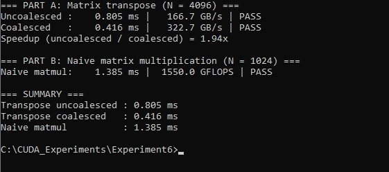

# Experiment 6 Screenshots Guide

This folder contains verified execution terminal screenshots from running Experiment 6 (Memory Optimization in CUDA).

| Filename | Purpose / Description | Expected Screen Content |
|:---|:---|:---|
| `01_execution_output.png` | Complete benchmark execution output | Execution of `exp6.exe` in `C:\CUDA_Experiments\Experiment6` showing Part A (Uncoalesced vs Coalesced Transpose with bandwidth and speedup), Part B (Naive Matrix Multiplication with GFLOPS), and the final summary table. |

### Execution Screenshot Preview

