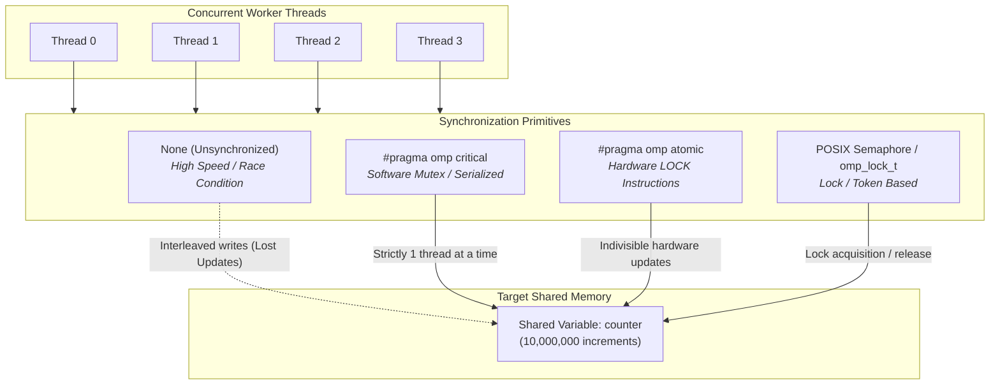
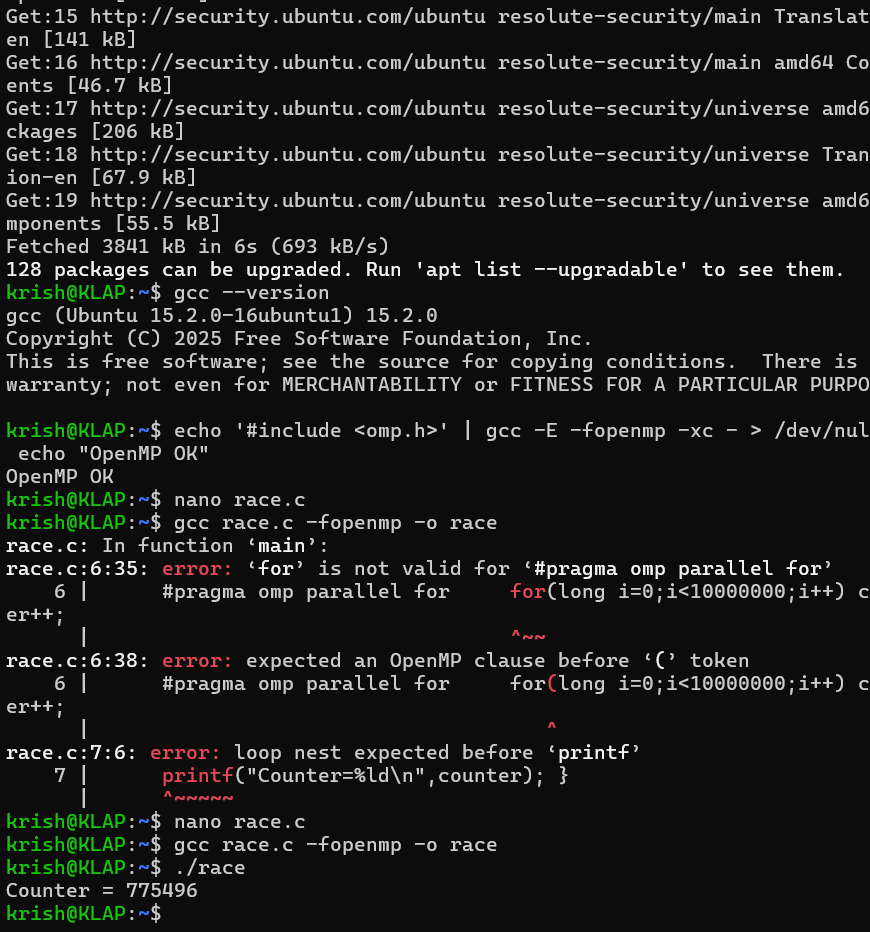
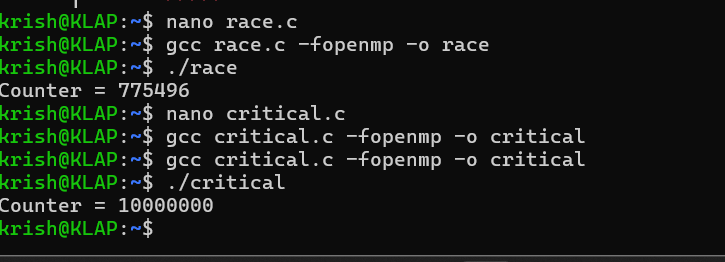
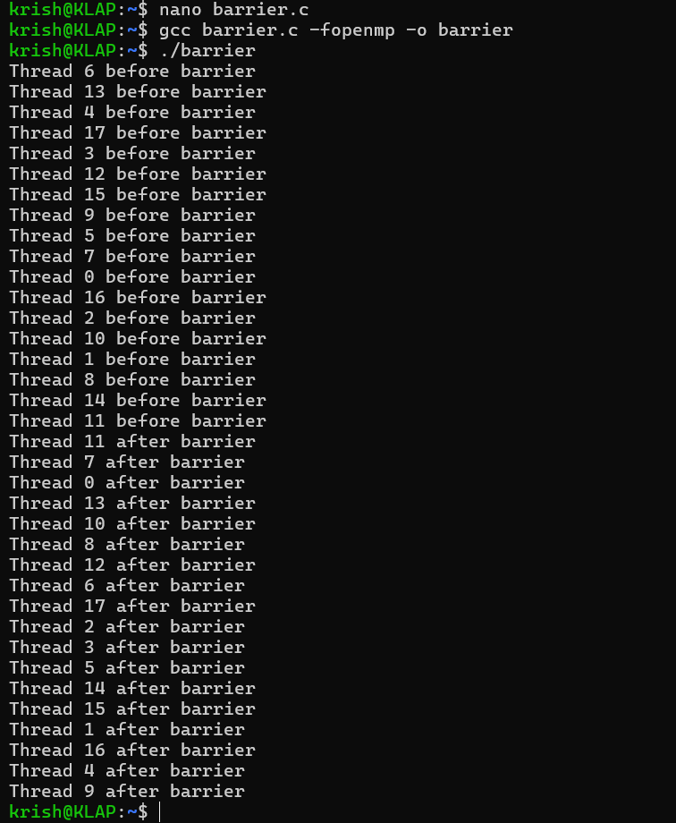
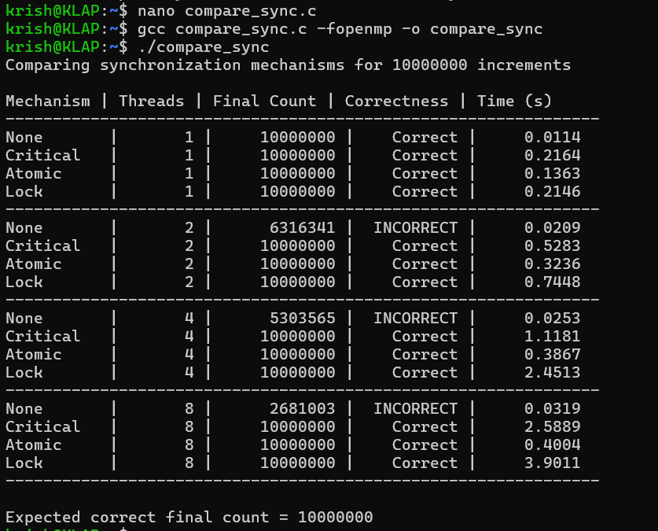

# Analyze Synchronization Mechanisms in Parallel Programs

## Experiment 5 — Parallel Computing Laboratory

**Author:** Krish-119  
**Institution:** KLE Technological University  
**Repository:** [https://github.com/Krish-119/pgc_lab](https://github.com/Krish-119/pgc_lab)  

---

## Table of Contents

- [1. Objective](#1-objective)
- [2. Software Requirements & System Specifications](#2-software-requirements--system-specifications)
- [3. Theoretical Background](#3-theoretical-background)
  - [3.1 Why Synchronization is Needed](#31-why-synchronization-is-needed)
  - [3.2 Race Condition](#32-race-condition)
  - [3.3 Critical Section](#33-critical-section)
  - [3.4 Atomic Operation](#34-atomic-operation)
  - [3.5 Barrier Synchronization](#35-barrier-synchronization)
  - [3.6 POSIX Semaphore](#36-posix-semaphore)
  - [3.7 Correctness vs. Performance vs. Scalability](#37-correctness-vs-performance-vs-scalability)
- [4. Architectural Diagram](#4-architectural-diagram)
- [5. Setup & Compilation Guide](#5-setup--compilation-guide)
- [6. Implemented Programs](#6-implemented-programs)
  - [6.1 Program 1: Race Condition (`race.c`)](#61-program-1-race-condition-racec)
  - [6.2 Program 2: Critical Section (`critical.c`)](#62-program-2-critical-section-criticalc)
  - [6.3 Program 3: Atomic Operation (`atomic.c`)](#63-program-3-atomic-operation-atomicc)
  - [6.4 Program 4: Barrier Synchronization (`barrier.c`)](#64-program-4-barrier-synchronization-barrierc)
  - [6.5 Program 5: POSIX Semaphore (`semaphore.c`)](#65-program-5-posix-semaphore-semaphorec)
  - [6.6 Program 6: Comparative Benchmark (`compare_sync.c`)](#66-program-6-comparative-benchmark-compare_syncc)
- [7. Experimental Execution Results & Screenshots](#7-experimental-execution-results--screenshots)
- [8. Benchmark Analysis & Performance Comparison](#8-benchmark-analysis--performance-comparison)
- [9. Comparison & Observation Table](#9-comparison--observation-table)
- [10. Conclusion](#10-conclusion)

---

## 1. Objective

To implement and study common synchronization mechanisms used in shared-memory parallel programs:
- Unsynchronized execution (demonstrating race conditions and silent update loss)
- Critical Sections (`#pragma omp critical`)
- Atomic Operations (`#pragma omp atomic`)
- Barrier Synchronization (`#pragma omp barrier`)
- Semaphores and Locks (POSIX `sem_t` and OpenMP `omp_lock_t`)

The experiment evaluates their:
1. **Correctness**: Whether the final result is strictly accurate regardless of thread scheduling.
2. **Execution Time**: The wall-clock run time across varying thread workloads.
3. **Scalability**: How execution time behaves as thread counts increase ($1 \to 2 \to 4 \to 8$).

---

## 2. Software Requirements & System Specifications

| S.No. | Software / Tool | Purpose / Environment Details |
|:---:|:---|:---|
| 1 | **VMware Workstation Pro** | Virtualization software hosting the guest OS |
| 2 | **Ubuntu Linux (krish@KLAP)** | Guest environment used for compilation and benchmarking |
| 3 | **GCC Compiler (v15.2.0)** | Compiles C programs (`build-essential`) |
| 4 | **OpenMP (`libgomp`)** | Provides `#pragma omp` parallel loops, critical, atomic, barrier, and lock APIs |
| 5 | **POSIX Threads (`pthread`) & Semaphores** | Standard library for thread spawning and binary semaphores (`semaphore.h`) |
| 6 | **Ubuntu Terminal** | Terminal interface to build, execute, and record timings |

---

## 3. Theoretical Background

### 3.1 Why Synchronization is Needed
In a shared-memory parallel program, multiple threads read and write the same memory location simultaneously. If two threads perform a read-modify-write sequence (such as `counter++`) without coordination, their CPU operations interleave in an unpredictable manner, silently discarding updates. Synchronization primitives provide language- and OS-level mechanisms to regulate access to shared data so that program execution remains deterministic and correct.

### 3.2 Race Condition
A race condition occurs when program outcome depends on the timing and scheduling sequence of threads accessing shared data without protection. 

The statement `counter++` is executed as three distinct machine operations:
1. **Load**: Read variable value into a CPU register.
2. **Modify**: Increment the register value by 1.
3. **Store**: Write the updated register value back to memory.

If Thread $A$ and Thread $B$ read the variable simultaneously before either writes the increment back, one increment is lost. Unsynchronized execution is fast because there is zero locking overhead, but results are incorrect and non-repeatable.

### 3.3 Critical Section
A critical section (`#pragma omp critical`) restricts execution of a code block to a single thread at a time. All other threads attempting to enter must wait.
- **Guarantee**: Total mutual exclusion for arbitrary code.
- **Cost**: Serializes parallel execution; contention increases drastically as thread count grows, turning synchronization into a scalability bottleneck.

### 3.4 Atomic Operation
An atomic operation (`#pragma omp atomic`) instructs the compiler to execute a single read-modify-write operation as an indivisible hardware instruction (e.g., `LOCK ADD` or `LOCK CMPXCHG` on x86/x64).
- **Guarantee**: Data integrity without the overhead of heavy OS mutexes or locks.
- **Cost**: Extremely low latency; scales significantly better than critical sections for primitive updates.

### 3.5 Barrier Synchronization
A barrier (`#pragma omp barrier`) establishes an execution checkpoint that all threads in a parallel team must reach before any thread is allowed to continue. Barriers synchronize execution phases rather than shared data directly.

### 3.6 POSIX Semaphore
A semaphore is an OS synchronization primitive based on an integer counter:
- `sem_wait(&s)`: Decrements the counter (blocks if already 0).
- `sem_post(&s)`: Increments the counter (releases waiting threads).
- A binary semaphore (initialized to 1) provides mutual exclusion across POSIX threads.

### 3.7 Correctness vs. Performance vs. Scalability
- **Correctness**: Does the algorithm produce the exact mathematically expected answer?
- **Performance**: How low is the wall-clock execution time for a given workload?
- **Scalability**: Does throughput scale or degrade when adding more threads?

---

## 4. Architectural Diagram



---

## 5. Setup & Compilation Guide

### Directory Navigation
The complete source code is located in [`Experiment-5-Synchronization-Mechanisms/src/`](Experiment-5-Synchronization-Mechanisms/src/).

### Compilation
You can compile all programs at once using `make`, or compile each individually using `gcc`:

```bash
# Using Makefile
cd Experiment-5-Synchronization-Mechanisms/src
make

# Or manual compilation:
gcc race.c -fopenmp -o race
gcc critical.c -fopenmp -o critical
gcc atomic.c -fopenmp -o atomic
gcc barrier.c -fopenmp -o barrier
gcc semaphore.c -pthread -o semaphore
gcc compare_sync.c -fopenmp -o compare_sync
```

---

## 6. Implemented Programs

### 6.1 Program 1: Race Condition (`race.c`)
Demonstrates unsynchronized concurrent increments across threads.
```c
#include <stdio.h>
#include <omp.h>

int main() {
    long counter = 0;
    #pragma omp parallel for
    for (long i = 0; i < 10000000; i++) {
        counter++;
    }
    printf("Counter=%ld\n", counter);
    return 0;
}
```

### 6.2 Program 2: Critical Section (`critical.c`)
Guarantees mutual exclusion using `#pragma omp critical`.
```c
#include <stdio.h>
#include <omp.h>

int main() {
    long counter = 0;
    #pragma omp parallel for
    for (long i = 0; i < 10000000; i++) {
        #pragma omp critical
        {
            counter++;
        }
    }
    printf("Counter=%ld\n", counter);
    return 0;
}
```

### 6.3 Program 3: Atomic Operation (`atomic.c`)
Protects counter modification via lightweight hardware-level atomic operations.
```c
#include <stdio.h>
#include <omp.h>

int main() {
    long counter = 0;
    #pragma omp parallel for
    for (long i = 0; i < 10000000; i++) {
        #pragma omp atomic
        counter++;
    }
    printf("Counter=%ld\n", counter);
    return 0;
}
```

### 6.4 Program 4: Barrier Synchronization (`barrier.c`)
Coordinates thread execution phases using `#pragma omp barrier`.
```c
#include <stdio.h>
#include <omp.h>

int main() {
    #pragma omp parallel
    {
        printf("Thread %d before barrier\n", omp_get_thread_num());
        #pragma omp barrier
        printf("Thread %d after barrier\n", omp_get_thread_num());
    }
    return 0;
}
```

### 6.5 Program 5: POSIX Semaphore (`semaphore.c`)
Demonstrates binary semaphore mutual exclusion with POSIX threads.
```c
#include <stdio.h>
#include <pthread.h>
#include <semaphore.h>

sem_t semaphore;
int counter = 0;

void* work(void* a) {
    for (int i = 0; i < 100000; i++) {
        sem_wait(&semaphore);
        counter++;
        sem_post(&semaphore);
    }
    return NULL;
}

int main() {
    pthread_t t1, t2;
    sem_init(&semaphore, 0, 1);
    pthread_create(&t1, NULL, work, NULL);
    pthread_create(&t2, NULL, work, NULL);
    pthread_join(t1, NULL);
    pthread_join(t2, NULL);
    printf("Counter=%d\n", counter);
    sem_destroy(&semaphore);
    return 0;
}
```

### 6.6 Program 6: Comparative Benchmark (`compare_sync.c`)
Compares None, Critical, Atomic, and Lock strategies across 1, 2, 4, and 8 threads for 10,000,000 increments using `omp_get_wtime()`.

---

## 7. Experimental Execution Results & Screenshots

### Output 1: Environment Verification & Race Condition
GCC 15.2.0 environment, OpenMP verification, and execution of `./race` demonstrating lost updates (`Counter = 775496` instead of `10000000`).



---

### Output 2: Critical Section Synchronization
Execution of `./critical` enforcing mutual exclusion and yielding the exact expected total (`Counter = 10000000`).



---

### Output 3: Barrier Synchronization
Execution of `./barrier` displaying thread phase synchronization across 18 worker threads.



---

### Output 4: POSIX Semaphore Synchronization
Execution of `./semaphore` with two concurrent threads yielding `Counter = 200000`.


---

### Output 5: Comprehensive Benchmark & Scalability Evaluation
Execution of `./compare_sync` across 1, 2, 4, and 8 threads evaluating execution time and correctness.



---

## 8. Benchmark Analysis & Performance Comparison

### Measured Empirical Data (krish@KLAP)

| Mechanism | Threads ($T$) | Expected Count | Final Count | Correctness | Execution Time (s) |
|:---|:---:|:---:|:---:|:---:|:---:|
| **None** | 1 | 10,000,000 | 10,000,000 | **Correct** | **0.0114** |
| **Critical** | 1 | 10,000,000 | 10,000,000 | **Correct** | 0.2164 |
| **Atomic** | 1 | 10,000,000 | 10,000,000 | **Correct** | 0.1363 |
| **Lock** | 1 | 10,000,000 | 10,000,000 | **Correct** | 0.2146 |
| | | | | | |
| **None** | 2 | 10,000,000 | 6,316,341 | ❌ **INCORRECT** | **0.0209** |
| **Critical** | 2 | 10,000,000 | 10,000,000 | **Correct** | 0.5283 |
| **Atomic** | 2 | 10,000,000 | 10,000,000 | **Correct** | **0.3236** |
| **Lock** | 2 | 10,000,000 | 10,000,000 | **Correct** | 0.7448 |
| | | | | | |
| **None** | 4 | 10,000,000 | 5,303,565 | ❌ **INCORRECT** | **0.0253** |
| **Critical** | 4 | 10,000,000 | 10,000,000 | **Correct** | 1.1181 |
| **Atomic** | 4 | 10,000,000 | 10,000,000 | **Correct** | **0.3867** |
| **Lock** | 4 | 10,000,000 | 10,000,000 | **Correct** | 2.4513 |
| | | | | | |
| **None** | 8 | 10,000,000 | 2,681,003 | ❌ **INCORRECT** | **0.0319** |
| **Critical** | 8 | 10,000,000 | 10,000,000 | **Correct** | 2.5889 |
| **Atomic** | 8 | 10,000,000 | 10,000,000 | **Correct** | **0.4004** |
| **Lock** | 8 | 10,000,000 | 10,000,000 | **Correct** | 3.9011 |

---

### In-Depth Scalability Analysis

1. **Unsynchronized (`None`)**:
   - Offers the fastest execution time (0.0114s - 0.0319s) due to absence of memory barriers and locking overhead.
   - However, data integrity degrades as thread concurrency rises:
     - 2 threads: **63.16%** accuracy (~36.8% lost)
     - 4 threads: **53.04%** accuracy (~47.0% lost)
     - 8 threads: **26.81%** accuracy (~73.2% lost)
2. **Atomic Operations (`#pragma omp atomic`)**:
   - Provides the best scalability and lowest latency among all valid synchronization methods.
   - Execution time rises from 0.1363s (1 thread) to only 0.4004s (8 threads), scaling effectively despite 8 threads contending for the same cache line.
3. **Critical Section (`#pragma omp critical`)**:
   - Degrades from 0.2164s (1 thread) to 2.5889s (8 threads) — an increase of **~12x**.
   - Causes intense thread serialization and context switching.
4. **Locks (`omp_lock_t`)**:
   - Degrades from 0.2146s (1 thread) to 3.9011s (8 threads) — an increase of **~18x**.
   - Explicit lock acquisition and release incur high overhead in tight loop bounds.

---

## 9. Comparison & Observation Table

| Mechanism | Correctness Guarantee | Relative Performance | Scalability Characteristics | Recommended Use Case |
|:---|:---:|:---:|:---|:---|
| **None (Race Condition)** | ❌ **Incorrect** (High Data Loss) | Fastest (Zero synchronization overhead) | **Poor** — Lost updates worsen as thread count increases | Baseline benchmarking / read-only data |
| **Critical Section** |  **Correct** | Slowest for high thread counts | **Poor** — Contention bottleneck grows with thread count | Multi-statement blocks, complex data updates |
| **Atomic Operation** |  **Correct** | **Fast** (Hardware-assisted) | **Excellent** — Low latency, minimal degradation with thread scaling | Single variable increments, arithmetic accumulators |
| **Lock (`omp_lock_t`)** |  **Correct** | Slow (High locking overhead) | **Poor to Moderate** — Thread convoying under tight loops | Fine-grained data structures, linked lists |
| **Barrier** | Phase Sync Only | Overhead proportional to slowest thread | **Moderate** — Limited by thread load imbalances | Multi-phase algorithms (e.g., iterative solvers) |
| **Semaphore** |  **Correct** | Moderate (OS syscall overhead) | **Moderate** — Good for resource management | Bounded buffers, producer-consumer queues |

---

## 10. Conclusion

1. **Race Conditions Cause Severe Data Loss**: Without synchronization, concurrent increments lose over 73% of updates at 8 threads.
2. **Atomics Provide the Best Speed and Scalability**: For simple variable updates, `#pragma omp atomic` is **6.5x faster than Critical** and **9.7x faster than Locks** at 8 threads.
3. **Lock Serialization Bottlenecks Performance**: Applying coarse locks across many threads introduces lock contention that slows execution as thread counts scale.
4. **Rule of Thumb**:
   - Single variable update: Use **Atomic**.
   - Complex code block: Use **Critical** or **Locks**.
   - Multi-phase thread alignment: Use **Barrier**.
   - Resource access throttling: Use **Semaphore**.

---

## Author

**Krish-119**  
*Parallel and GPU Computing Laboratory*  
GitHub: [https://github.com/Krish-119/pgc_lab](https://github.com/Krish-119/pgc_lab)
